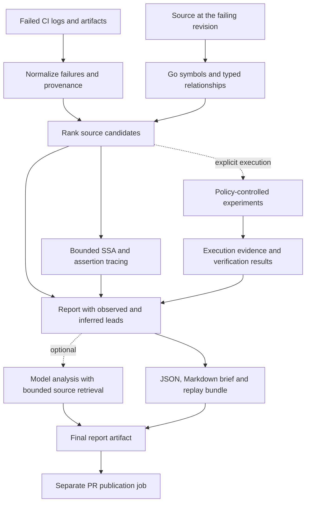
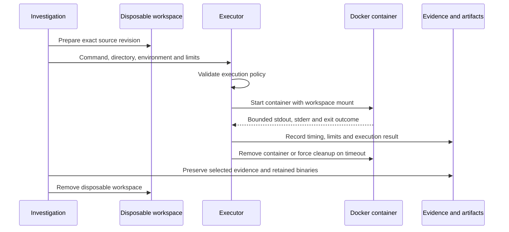

# Ceaser

### CI failure diagnosis, starting with Go

Ceaser reads failed CI runs and updates one comment on the pull request.
See the failing test, the reported error, and the source locations worth
inspecting. Expand the evidence or download a brief when you need more context.

**Current adapter — Go, alpha.** Additional language adapters are planned.
The existing cross-language parsers and environment detection are foundations
for that work. They have not received the same end-to-end validation as Go.

[Install locally](#try-it-locally) · [Connect GitHub Actions](#add-it-to-github-actions) ·
[Architecture](#architecture) · [Sandbox execution](docs/sandbox-execution.md) ·
[Read the reports](#read-or-share-the-detailed-report) · [Contribute](#contributing)

## What you get

| On the pull request | In the downloadable report | In your own assistant |
| --- | --- | --- |
| A short failure summary and up to two source leads | Failed checks, source excerpts, evidence, and next checks in `ceaser-brief.md` | A paste-ready brief from `ceaser brief --report report.json --prompt` |
| Expand **Diagnosis details** for the reasoning behind a lead | Inspect `ceaser-report.json` for the structured record | Export locally without calling a model |

## Why the engine is structured this way

A CI failure gives you several different questions: what failed, which code is
worth inspecting, whether it reproduces, whether the PR introduced it, and what
caused it. Ceaser records those questions separately so an answer to one does
not silently become an answer to another.

| Design choice | What it gives you |
| --- | --- |
| Original CI evidence first | An investigation can start from the failure that actually happened, even when its environment cannot be reproduced locally. |
| Source analysis before optional model analysis | Source locations, relationships, excerpts and evidence references are available to a developer or model from the same report. |
| Separate observed and inferred locations | A runtime stack frame and a likely caller have different labels and can be checked separately. |
| Shared execution interface | Reproduction, comparisons and probes use execution policies, bounded output and explicit terminal results. |
| Disposable workspaces and a Docker backend | Experiments can use an isolated revision with a documented execution boundary. |
| Recorded investigation state | Evidence, hypotheses, activities and verification results remain inspectable beyond the short comment. |
| Separate analysis and publication jobs | Model credentials and comment credentials stay out of the job that handles target execution. |
| Independent report export | A useful investigation brief can be generated and shared without a model call. |

Measured localization and verification results are listed under
[validation](#status), with links to the reports and their limits.

## Try it locally

Linux x86_64 users can [install the v8 binary](docs/installation.md#install-a-released-binary).
To build locally, you need Go 1.26, Git, and a C compiler for SQLite. Docker is
needed only when you choose the Docker executor:

```sh
git clone https://github.com/ceaser-org/ceaser.git
cd ceaser
mkdir -p "$HOME/.local/bin"
go build -o "$HOME/.local/bin/ceaser" ./cmd/ceaser
export PATH="$HOME/.local/bin:$PATH"
ceaser version
```

Analyze a saved CI log against the checkout it came from:

```sh
ceaser diagnose \
  --repo /path/to/checkout \
  --ci-log /path/to/failed-ci.log \
  --artifact-first --json > report.json
```

Check out the revision that produced the log so source locations can be
matched to the right code. If you only have the log, run
`ceaser evidence --ci-log /path/to/failed-ci.log`.

## Add it to GitHub Actions

After installing the CLI, run this from the repository you want to diagnose:

```sh
ceaser init
```

It detects project and workflow evidence, then proposes `.ceaser.yml` and
`.github/workflows/ceaser.yml`. Review the command and watched workflow name,
then commit both files on your default branch. Existing files require
confirmation before replacement. Future failed runs download the prebuilt CLI;
maintainers do not need to rebuild Ceaser for each investigation.

<details>
<summary><strong>What init generates: manual caller example</strong></summary>

Save this as `.github/workflows/ceaser.yml` if you prefer manual setup. Replace
`CI` with the name of the workflow that runs your Go tests.

```yaml
name: Ceaser

on:
  workflow_run:
    workflows: [CI]
    types: [completed]

permissions:
  actions: read
  contents: read
  issues: write
  pull-requests: write

jobs:
  diagnose:
    if: |
      github.event.workflow_run.conclusion == 'failure' &&
      github.event.workflow_run.head_repository.full_name == github.repository
    uses: ceaser-org/ceaser/.github/workflows/ci-diagnose.yml@v8
    with:
      run_id: ${{ github.event.workflow_run.id }}
      head_sha: ${{ github.event.workflow_run.head_sha }}
      base_sha: ${{ github.event.workflow_run.pull_requests[0].base.sha }}
```

</details>

**v8 uses a prebuilt, checksum-verified binary.** Ceaser is built once per release,
not once per diagnosis. Target tests may still need their own compilation.
GitHub-hosted runners are supported; Blacksmith is not required.

This example uses evidence from same-repository runs and excludes fork PRs.
Ceaser updates its existing comment on later failures. It puts the report and
supporting logs in a workflow artifact. Use `comment_detail: detailed` to show
the evidence section by default, or `comment: false` to publish only the workflow
summary and artifact. For reproducible installs, pin the reusable workflow
reference to a full commit SHA. The binary defaults to `ceaser_version: v8`;
`main` opts into development source builds. See [integration options](docs/ci-integration.md).

For a custom job, use the setup action:

```yaml
steps:
  - uses: ceaser-org/ceaser@v8
  - run: ceaser version
```

This step installs the CLI. The reusable workflow above handles evidence
collection, artifacts and PR comments. Ceaser runs in your Actions account;
the default integration does not require a hosted service or App installation.
An optional repository-owned GitHub App can supply a custom comment author;
see [bot configuration](docs/ci-integration.md#optional-custom-comment-author).

<details>
<summary><strong>Configuration reference</strong></summary>


Run `ceaser init` from your repository to review a proposed `.ceaser.yml` and
GitHub Actions caller. If it cannot find a test command, add the command from
the failing CI job yourself. You can also write the config by hand.

```yaml
command: go test ./...
attempts: 3
timeout: 10m
executor: local
```

| Setting | When to use it |
| --- | --- |
| `command` | Set the exact test command, including any package or test filter used in CI. |
| `attempts`, `timeout` | Control explicit reproduction runs. |
| `base` | Supply the known base revision for a comparison when you intend to run one. |
| `executor`, `image` | Choose the local or Docker executor. Docker requires an image. |
| `--ci-log`, `--junit`, `--artifact-dir` | Read existing evidence from files. |
| `--artifact-first` | Start from existing evidence. Keep explicit execution options off for log-only triage. |

For a trusted local checkout, running `ceaser diagnose --repo . --command
'go test ./...'` explicitly asks Ceaser to run the command. See the
[installation guide](docs/installation.md) and
[workflow input reference](docs/ci-integration.md#inputs) for the full setup.

</details>

## Read or share the detailed report

Open the workflow run linked in the PR comment, then download the
`ceaser-diagnosis-<run-id>` artifact. Open `ceaser-brief.md` to read the
report or `ceaser-report.json` for the full structured evidence. See the
[report guide](docs/reports.md) for each output and its location.

You can also export a brief locally. Add `--prompt` when you want a version
you can paste into another assistant. Review the excerpts before sharing
logs or private source code.

```sh
ceaser brief --report report.json > ceaser-brief.md
ceaser brief --report report.json --prompt > ceaser-prompt.md
```

## What a comment can tell you

On [Kubernetes PR #143709](https://github.com/kubernetes/kubernetes/pull/143709),
the original failure log showed a race between cacher startup and test cleanup.
Ceaser connected the detector markers to overlapping `WaitGroup.Add` and
`Wait` calls. It reported the two stack locations and left the exact call and
PR attribution unresolved. [View the run and report](https://github.com/ceaser-org/ceaser/actions/runs/44322156729).

On the [Ceaser smoke PR](https://github.com/ceaser-org/ceaser/pull/25#issuecomment-6980363714),
the test expected `"ready"` and got `"pending"`. The assertion line was the
useful location. There was no application call to investigate.

## Status

Ceaser is a Go-first alpha. It separates observed failures, inferred code leads,
and verified mechanisms. Stack locations and likely files can narrow the search.
They cannot establish that the PR caused a failure. Runtime probes and verified
mechanism checks are experimental.

On 14 reviewed cases that ran their intended tests, Ceaser included the culprit
file in its first five candidates in 10 cases. The first five raw log locations
included it in 7. The lists had different lengths, and the comparison used a
small development set. The later 16-case probe run verified zero mechanisms.
See the [file comparison](evaluation/go-probe-preflight.md) and
[probe results](evaluation/probe-rerun/README.md).

## Architecture



The engine is implemented in Go. Parsing, repository analysis, execution,
verification, storage and optional model access have separate packages. The
[full architecture guide](docs/runtime-architecture.md) maps them to source files.

### Evidence ingestion and source identity

Log and artifact parsers extract failed tests, expected/actual messages, panic
frames, compiler diagnostics, race accesses and supported coverage records.
The original bounded evidence is retained alongside normalized failure episodes.
Evidence items carry IDs and provenance; source revisions, artifact digests and
execution identifiers are retained where available.

A source line from one revision and a binary offset from another build are not
interchangeable. Ceaser keeps that distinction when mapping runtime evidence.
With usable original failure evidence, the report records local reproduction
as deferred instead of counting the original CI failure as a new reproduction.

### Go analysis: file, function, operation

The repository layer uses Go's standard AST parser for declarations and source
locations. Typed call analysis and SSA use `golang.org/x/tools`. They add
receiver/package-aware relationships and bounded value dependencies around
selected functions and failing assertions.

Localized implementation candidates feed operation selection, including when
backward assertion tracing is incomplete. Source fallbacks use implementation
stack frames or executed coverage ranges. SSA and source candidates share the
bounded probe shortlist. In v8, when neither supplies an operation,
explicit runtime probing can test returns in exact localized implementation
functions as hypotheses. That fallback rotates between functions and records
its selection reason; it does not confer static dataflow proof. Missing type
information or unsupported operations can still leave only a file/function lead.

The report keeps three distinctions visible:

| Result | What it means |
| --- | --- |
| Observed location | CI output or an execution reported this file, line or stack frame. |
| Inferred candidate | A source relationship or ranking rule points here; inspect it against the failure. |
| Verified mechanism | The required operation, execution, correlation and proof checks support the stronger claim. |

A candidate rank is a search priority, not a calibrated probability that a
function is defective. A root-cause finding and PR attribution are separate.

### Investigation scheduling and verification

The investigation layer records hypotheses, unresolved objectives, activities
and experiments. Its scheduler ranks available actions using diagnostic
relevance, expected uncertainty reduction, discrimination, evidence quality,
execution cost, risk and latency. Iteration, activity, experiment and time
budgets bound further work. This is an explicit action registry and scoring
policy; it is not an unrestricted autonomous debugger.

Extra execution paths are selected deliberately:

- Reproduction runs the configured command in a disposable revision workspace.
- Base/head comparison records each revision's outcome for the same command.
- The Go cold path retains the exact focused test binary and its provenance.
- Runtime probes instrument supported operations and record candidate, build,
  execution, failure-preservation and invocation-correlation outcomes.
- Repair is a separate opt-in path with isolated verification results.

An observed value alone does not promote a root cause. Runtime verification
requires stronger evidence, including the right failing invocation, source and
revision identity, cited evidence and supported dataflow/mechanism checks.
Those checks currently cover a limited set of mechanisms and remain experimental.

### Execution and sandbox orchestration

Ceaser owns the orchestration: workspace preparation, command policy,
cancellation, output collection, execution records and cleanup. Docker provides
the container boundary. No third-party hosted sandbox account is required.



The diagram shows the Docker path. Local execution uses the same executor
interface but runs directly on the runner.

| Boundary | Local executor | Docker executor |
| --- | --- | --- |
| Process location | Runner host | Disposable container |
| Command/directory/environment policy | Enforced | Enforced |
| Output and time bounds | Enforced | Enforced |
| OS isolation | Runner's existing boundary | Container boundary, sharing the host kernel |
| Network | Host network policy | Disabled for the execution container |
| Filesystem | Host access under runner privileges | Read-only container root; writable workspace mount and temporary filesystem |
| Privileges and resources | Host/runner limits | Dropped capabilities, no privilege escalation, caller UID/GID and configured CPU/memory/process limits |
| Cancellation | Process-group cleanup | Container removal with recorded cleanup outcome |

A temporary worktree protects the source checkout from normal build writes; it
is not an OS security boundary. Local mode is the CLI default. The Go cold path
requires Docker, and the starter workflow excludes fork PRs. Prepared images
must contain the dependencies needed for network-disabled execution.
See [sandbox execution](docs/sandbox-execution.md) for the lifecycle, policies,
artifact capture and failure handling.

### Optional model harness

The model receives a bounded package of failures, candidate functions, source
excerpts, reproduction status and evidence references from the deterministic
report. This reduces the amount of raw investigation material that needs to
be selected manually before asking a model for an explanation.

When enabled, source retrieval lets the model request up to five read-only Go
lookups in a batch: a file excerpt or literal search at the reported Git commit.
Retrieval has path, size and time bounds. Search results are textual leads;
they do not become verified call edges. This is currently Git-based retrieval,
not an embedding index or a general shell tool.

Model interpretation is labeled separately. The harness validates evidence
references and constrains output, but citation validity is not semantic proof.
The model cannot change deterministic classification or verification fields.
The report survives a model-analysis failure. See
[model setup](docs/ci-integration.md#inputs) and
[the retrieval implementation](internal/agent/retrieval.go).

### Persistence, memory and caches

These have different purposes and invalidation rules:

| Layer | Stores | Reuse rule |
| --- | --- | --- |
| Repository artifact cache | Repository overviews and source snapshots | Keyed by repository, commit, analyzer version and artifact identity |
| SQLite investigation state | Executions, evidence, hypotheses, activities, experiments and verification records | Available when the same store is retained |
| Historical incident retrieval | Similar failures and symbol associations from previous investigations | Repository-scoped, with prior revision and uncertainty attached |
| Go module/build caches | Dependencies and compiler output | Managed separately by the target toolchain and workflow |

Historical similarity is context for investigation, not proof that the same
bug happened again. Ceaser does not cache diagnostic conclusions as universal
facts. Fresh GitHub-hosted jobs do not gain durable incident memory automatically;
you must preserve the relevant store and cache if you want reuse across runs.

The optional gateway exposes model access and persisted investigation events.
A separate stdio MCP server exposes local investigation tools to agent clients.
Neither service is required for the default PR-report integration. See the
[gateway and MCP reference](docs/runtime-architecture.md#gateway).

## Adapter roadmap

| Adapter | Availability |
| --- | --- |
| **Go** | Available in this alpha. Go test output, assertion and panic locations, source relationships, and race evidence. |
| JavaScript / TypeScript | Planned. Existing environment detection and report parsing need runner-specific validation. |
| Python | Planned. Existing traceback parsing and environment detection provide a starting point. |
| Java / Kotlin | Planned. Existing JUnit and exception parsing provide a starting point. |
| Rust | Planned. Existing Cargo detection and diagnostic parsing provide a starting point. |

There are no release dates for additional adapters. Contributions with real
failure logs and reproducible tests will help define their scope. See
[adapter coverage](docs/supported-environments.md) for the implementation
foundations already present.

## Troubleshooting

<details>
<summary><strong>Common setup issues</strong></summary>


| Symptom | What to check |
| --- | --- |
| No diagnosis run | The caller must be on the default branch. Check the name under `workflows:` and confirm that the source run failed. |
| Summary exists without a PR comment | Check that GitHub associated the source run with a PR, `comment` is on, and the caller grants the publishing permissions shown above. The example excludes forks. |
| The report points only to a test | Inspect the assertion first. If a stack frame points to application code, check that the source checkout matches the failing revision. |
| A rerun fails during setup | Check the Go version, working directory, dependencies, and required services. Analyze existing logs if a local run cannot match CI. |
| Missing Markdown brief | Open the Ceaser run’s diagnosis artifact and check the **Export investigation brief** step. If the artifact contains `ceaser-report.json`, use `ceaser brief --report ceaser-report.json > ceaser-brief.md` with a current build. [Details](docs/reports.md#if-the-brief-is-missing). |

Use the documented same-repository workflow guard for the starter setup.
Review logs, source excerpts, and exported briefs before sharing them
outside your project.

</details>

## Contributing

See [CONTRIBUTING.md](CONTRIBUTING.md) for setup, where to make changes,
fixture guidelines, and how to submit a useful bug report or PR.

```sh
go test ./...
go vet ./...
go build ./...
```

| Reference | Contents |
| --- | --- |
| [Installation](docs/installation.md) | Source builds, released binaries, and common setup failures |
| [CI integration](docs/ci-integration.md) | Workflow inputs, permissions, and execution options |
| [GitHub Action](docs/github-action.md) | Setup action, custom jobs, release installation and Marketplace |
| [Adapter coverage](docs/supported-environments.md) | Current Go adapter and foundations for planned adapters |
| [Runtime architecture](docs/runtime-architecture.md) | End-to-end flow, source analysis, probes, model harness, trust boundaries and storage |
| [Sandbox execution](docs/sandbox-execution.md) | Workspace lifecycle, executor policy, Docker isolation, artifacts and cleanup |
| [Reports and briefs](docs/reports.md) | Find the artifact, read the report, or export a missing brief |
| [External validation](docs/external-validation.md) | Live PR and upstream CI checks, with limits |
| [Diagnosis evaluation](docs/diagnosis-evaluation.md) | Running and interpreting evaluation checks |
| [Evaluation corpus](evaluation/corpus/) | Saved failures and scoring labels |

[Open an issue](https://github.com/ceaser-org/ceaser/issues/new) with a CI run
and what you expected the comment to report.

Licensed under [Apache 2.0](LICENSE).
