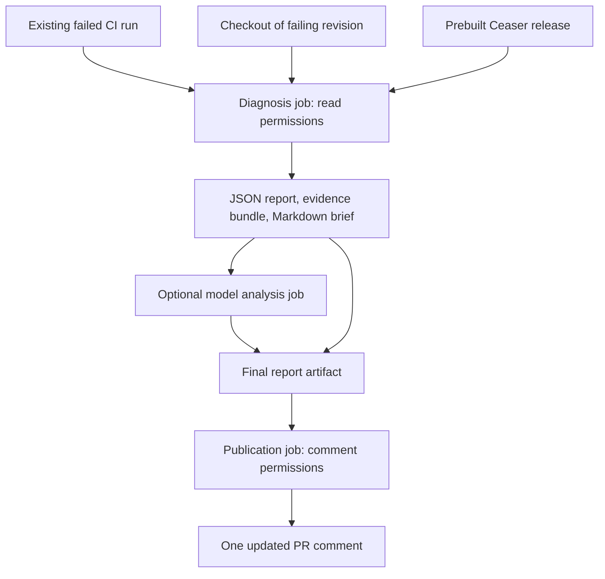

# How Ceaser works

Ceaser is a Go-first CI failure triage tool. Its default GitHub integration
reads evidence from an existing failed run, inspects the failing revision, and
publishes source leads. It can collect more evidence through explicit test
execution. Optional model analysis consumes the deterministic report afterward.

## Components and deployment



The three jobs are defined in
[ci-diagnose.yml](../.github/workflows/ci-diagnose.yml). They run in the caller's
GitHub Actions account. There is no Ceaser-hosted service, no Blacksmith
requirement, and no model subscription required for the default path.

| Component | Responsibility | Location |
| --- | --- | --- |
| CLI | Configuration, evidence ingestion, diagnosis, brief export | `cmd/ceaser/` |
| Evidence parsers | Logs, test reports, compiler/race evidence, coverage artifacts | `internal/diagnosis/` |
| Repository analysis | Source symbols, typed Go calls, bounded SSA graphs | `internal/repository/` |
| Investigation pipeline | Candidate ranking, hypotheses, optional deeper investigation | `internal/diagnosis/pipeline.go` |
| Runtime probes | Candidate selection, instrumentation, execution and correlation | `internal/diagnosis/runtime_*.go` |
| Execution | Local commands and Docker execution policies | `internal/execution/` |
| Optional model harness | Bounded evidence input, source retrieval and output validation | `internal/agent/` |
| State and history | SQLite records and historical incident lookup | `internal/persistence/`, `internal/history/` |
| GitHub integration | Evidence download, artifact transfer, comment update | `.github/workflows/ci-diagnose.yml` |
| Setup action | Download and verify a released CLI; add it to PATH | `action.yml` |

## 1. Identify the execution

The caller supplies the failed run ID and head commit. Ceaser checks out that
revision and downloads the failed jobs' logs and available artifacts. A base
commit can be recorded too. Knowing the base commit alone does not establish
that the PR introduced the failure.

Evidence keeps source/run identifiers and digests where available. A stack
location is meaningful only against its matching source revision. Rebuilt
binaries cannot be used to resolve offsets from the original CI binary.

## 2. Normalize observed failures

The parsers turn Go test output, assertions, panic stacks, compiler diagnostics,
race reports and structured test artifacts into failure episodes and evidence
items. Raw bounded evidence remains available for inspection. Coverage profiles
can supply executed source ranges when uploaded by the original CI run.

The reusable workflow does not currently generate coverage automatically.
Missing coverage is reported as missing evidence, not treated as proof that a
function was unexecuted.

With usable failure evidence and artifact-first mode, the original run supplies
the observed failure. Local reproduction is marked deferred. With no usable
failure evidence, `diagnose` can enter the configured reproduction path; see
[CI integration](ci-integration.md) before enabling command execution.

## 3. Find source leads

Ceaser maps observed file/line locations to source symbols, uses typed Go call
relationships where available, and ranks implementation candidates. The report
distinguishes observed stack frames from inferred callers and other source
leads. The bounded candidate report contains up to five entries; the short PR
comment displays fewer leads to stay readable.

For Go, parsing uses the standard library AST. Typed calls and SSA use
`golang.org/x/tools`. SSA describes possible value dependencies and can trace
backward from a failing assertion. Localized implementation functions also
supply SSA candidate operations when the assertion trace is incomplete.

Analysis is bounded. Missing dependencies, unresolved interface calls, package
budgets and unsupported expressions can leave a graph incomplete. Finding a
file or reaching a constructor does not establish the failing operation.

## 4. Collect additional evidence when requested

These are separate capabilities; they are not all enabled by installing Ceaser.

| Path | Trigger | What it establishes |
| --- | --- | --- |
| Existing CI evidence | Failed log/report supplied | A failure was observed in that execution |
| Reproduction | Explicit command execution, or normal diagnosis without usable original failure evidence | Outcome of the configured command in the new environment |
| Base comparison | Base supplied and execution permitted | Whether the targeted command fails on each revision |
| Go cold path | `--go-cold-path`, Docker required | Focused test execution with a retained binary and provenance |
| Runtime operation probes | `--runtime-observation` | Values observed at selected source operations; stronger proof requires correlation |
| Repair | Explicit repair command/options | Proposed patch and separately recorded verification outcome |

Probe selection mixes SSA operations with source candidates anchored by stack
frames or existing coverage. It tries a bounded set of candidates, instruments
supported expressions, preserves evaluation order, and retains the executed
binary digest. Unsupported rewrites abstain. A source-only operation cannot
satisfy the SSA verification requirement by itself.

In v8, an empty operation shortlist can fall back to exact localized
implementation declarations. This last-resort path tests single-expression
returns, rotates between up to five functions within the existing five-operation
budget, and records `selection_reason: localized_function_hypothesis`. It does
not assume the function ran in the original CI execution. Ambiguous declarations,
file-only leads, tests, stale ranges and paths outside the workspace are rejected.

Failure preservation also recognizes sequential native Go test output, including
GitHub job-log prefixes. It requires the same failing test set, one matching
file/line check and an unambiguous expected/actual signature across repeats.
Parallel native streams and repeated or conflicting check blocks abstain.
Invocation correlation and mechanism verification remain separate requirements.

Testify matching also checks the exact numeric file/line and a single named
assertion block. Identical copies of a complete CI log retained in different
report fields are deduplicated for probe matching; repeated checks inside one
log remain ambiguous. Signature labels are not inferred from identifiers such
as `actual_test.go` or from empty expected/actual fields.

The runtime loop records candidate selection, build, execution, failure
preservation and invocation-correlation outcomes separately. A logged value is
a useful observation, but matching a number without binding it to the failing
invocation is not a verified mechanism. The strict promotion path also requires
matching revision, cited evidence, exact dataflow support and a supported
mechanism check. Arbitrary Go bugs are outside the current verifier's coverage.

## 5. Render what the evidence supports

The engine records classification, reproduction status, observed incidents,
candidates, uncertainty and next checks. The candidate tier is presentation-only;
it does not promote a root-cause claim. Some reports identify only the test or
leave the mechanism unresolved. Those outcomes are included in evaluation.

`ceaser-report.json` is the structured record. `ceaser brief` turns it into a
readable Markdown brief without invoking a model or rerunning the program.
The publication job renders a short comment with expandable detail and updates
its existing comment. See [reports](reports.md).

## 6. Optional model investigation

When `agent: true`, a separate job passes a bounded evidence package to the
configured model gateway. With `agent_code_retrieval: true`, the model may
request bounded Go source snippets/search results from Git objects at the
reported revision. This is source retrieval, not a vector database or an
unrestricted shell agent.

The harness constrains requests, sizes and evidence references. Model output is
labeled separately and cannot change deterministic classification or mechanism
verification. Valid evidence IDs do not guarantee that the model's explanation
is correct. A model failure leaves the original report available.

## Runtime and security boundaries

Ceaser's orchestration and the Docker isolation boundary are documented
separately in [Execution and sandbox orchestration](sandbox-execution.md).
That guide covers workspace creation, policy validation, command lifecycle,
output and artifact capture, cancellation and cleanup, with links to the code.

- v8 downloads a checksum-verified Linux amd64 binary. Ceaser is built once per
  release. Setting `ceaser_version: main` explicitly selects a development build.
- Target toolchain setup, dependency resolution and test compilation are separate
  costs. Prebuilding Ceaser does not prebuild arbitrary target repositories.
- Local execution runs with the runner's privileges. It is not a container.
- The Docker executor uses a disposable container, disables networking, drops
  capabilities, applies resource limits and mounts an isolated workspace. The
  image/dependencies must be prepared before a network-disabled test run.
- Diagnosis has read permissions and does not persist checkout credentials.
  Optional analysis receives only its configured gateway secrets. Publication
  consumes report artifacts and has comment permissions.
- The starter caller excludes fork PRs. Do not remove that guard without reviewing
  the execution and publication boundary for your deployment.
- Logs and briefs can contain private source or sensitive output. Review before
  sharing. Ceaser does not send telemetry by default; enabling an external model
  sends the selected evidence to the configured provider.

## What the alpha has demonstrated

The small reviewed development set localized the culprit file in 10 of 14
cases, compared with 7 of 14 using stack-file extraction. List sizes differed.
The frozen 16-case probe rerun preserved one probe and verified zero mechanisms.
These are separate measurements, not a general root-cause success rate.
See [evaluation](diagnosis-evaluation.md) and
[external validation](external-validation.md) for the artifacts and limits.

## Persistence

Ceaser can persist investigations, lifecycle events, evidence, hypotheses,
experiments, patches, and verification reports in SQLite. The store is used by
the gateway and MCP server when they need durable investigation state.

Persistence does not make a diagnosis correct. It records what was observed so
that the result can be inspected and recovered.

Repository artifact caching and incident memory are separate. The artifact
cache keys overviews and snapshots by repository identity, commit, analyzer
version and artifact identity. Historical retrieval queries the retained store
for related failures and symbols in the same repository, preserving prior
revisions and uncertainty. It does not turn a previous diagnosis into a current
fact. Fresh hosted runner jobs need explicit store/cache persistence to reuse
that context across runs.

## Gateway

The gateway is a small OpenAI-compatible HTTP adapter. It keeps provider-specific
wire formats outside the diagnosis engine and can use Ollama, OpenAI-compatible
providers, Gemini, or another configured upstream supported by the repository.

Start it locally with:

```sh
CEASER_GATEWAY_PROVIDER=ollama \
CEASER_GATEWAY_MODEL=qwen2.5:7b \
go run ./cmd/gateway
```

Endpoints:

- `GET /health`
- `GET /v1/models`
- `POST /v1/chat/completions`
- `GET /v1/investigations/<id>/events`

The gateway currently handles non-streaming model completions. Request and
output limits are enforced by the gateway and provider clients.

## Server-Sent Events

`GET /v1/investigations/<id>/events` streams persisted investigation lifecycle
events as Server-Sent Events.

The stream:

- sends the existing events after the supplied cursor;
- accepts `Last-Event-ID` for reconnecting;
- polls for newly persisted events;
- sends keepalive comments every 15 seconds;
- closes when the client context ends.

If the gateway was started without a SQLite store, model requests still work,
but the SSE endpoint returns that investigation streaming is unavailable.

Example:

```sh
curl -N \
  -H 'Accept: text/event-stream' \
  http://127.0.0.1:8787/v1/investigations/INVESTIGATION_ID/events
```

## MCP server

The MCP server is a separate local integration for agent clients. It uses stdio
JSON-RPC and requires an explicitly authorized repository root.

```sh
go build -o ceaser-mcp ./cmd/mcp-server
./ceaser-mcp --root "$PWD" --db "$PWD/.ceaser/mcp.db"
```

The server exposes tools for starting and cancelling investigations, reading
investigations and evidence, inspecting hypotheses and experiments, and reading
patch and verification reports.

The server restricts repository roots, executable commands, request and
response sizes, timeouts, and environment variables. It is intended for local
use and is not the GitHub Actions integration.
