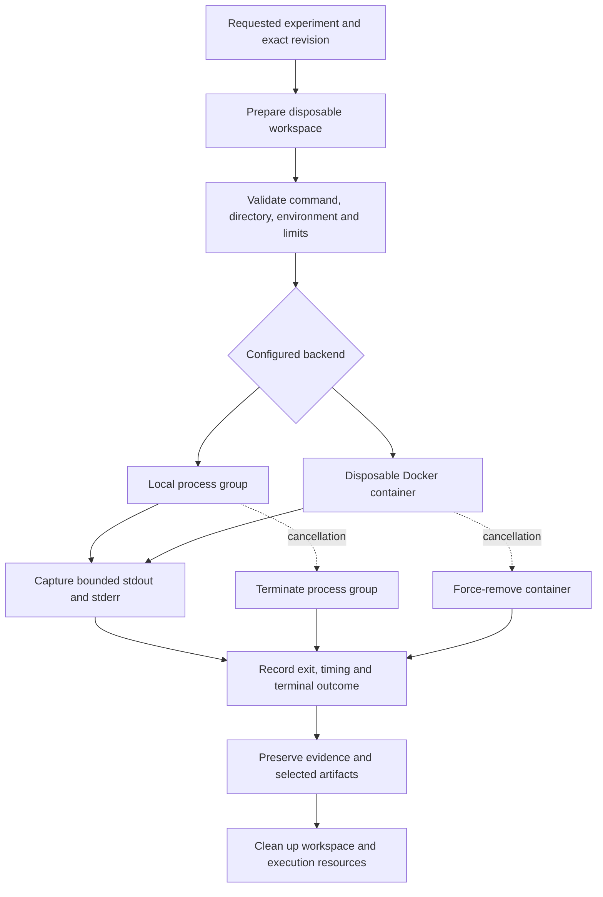

# Execution and sandbox orchestration

Ceaser implements its own execution orchestration in Go. It prepares revision
workspaces, validates execution requests, invokes a local process or Docker,
collects bounded output, records results and cleans up resources. Docker supplies
the container isolation. There is no Ceaser-managed VM fleet or external
sandbox service in the current release.

This page describes execution that is actually requested. Reading original CI
failure evidence does not mean Ceaser ran the failing test again.

## Layers and ownership

| Layer | Owns | Source |
| --- | --- | --- |
| Diagnosis and experiment callers | Revision, command, experiment purpose and evidence interpretation | `internal/diagnosis/` |
| Workspace management | Detached Git worktrees and temporary probe copies | `internal/diagnosis/git.go`, `internal/diagnosis/runtime_observation.go` |
| Executor interface | Execution request and result boundary | `internal/execution/executor.go` |
| Policy | Allowed top-level commands, directories, environment names, output and time bounds | `internal/execution/executor.go` |
| Local backend | Host process lifecycle, process groups and output capture | `internal/execution/executor.go` |
| Docker backend | Container options, execution, cancellation and removal | `internal/execution/executor.go` |
| Artifact factory | Size-bounded artifacts, digests and stored file metadata | `internal/execution/executor.go` |
| Investigation state | Evidence, activities, experiments and their recorded outcomes | `internal/domain/`, `internal/persistence/` |

All backends implement `Executor.Run(context, ExecutionRequest)`. A caller
submits a command and its arguments, working directory, environment, timeout,
output bound and execution identity. Container requests also identify the
workspace to mount. The caller interprets the result; the executor does not
decide which source function caused a failure.

## Workspace and execution lifecycle

Normal reproduction creates a detached worktree at the recorded commit. Base
and head comparisons use revision workspaces rather than rewriting the user's
checkout. Runtime instrumentation uses a separate bounded source copy so probe
edits are disposable. Its copy policy can omit fixtures or generated material;
an instrumented test that fails to build is not evidence of the original bug.

Selected runtime evidence must survive removal of the workspace. For example,
the Go cold path can preserve the focused test binary, toolchain and revision
metadata; runtime operation probes digest the exact binary they execute.
Original CI binary offsets are only resolvable with matching original build
evidence. A newly compiled binary supplies evidence about the new execution.

## Local execution

`--executor local` is the default. It applies the command policy, uses a timeout,
collects output and manages child processes. Compiler and test descendants are
placed in a process group so cancellation can terminate the group.

It runs with the host runner's permissions and network access. A temporary
directory or Git worktree is not a sandbox boundary: a process with host access
can access more than its working directory. Use local execution only within a
trust boundary appropriate for the source and configured command.

## Docker execution

Choose Docker explicitly with `--executor docker --image <prepared-image>` or
the equivalent configuration. The image must already provide the required
toolchain and dependencies. The backend launches a new container per command.

| Control | Implementation |
| --- | --- |
| Network | `--network none` |
| Container root | `--read-only` |
| Working source | Bind-mounted disposable workspace at `/workspace`, writable for build output |
| Temporary files | Writable `/tmp` tmpfs with `nosuid,nodev`; `HOME` and `TMPDIR` point there |
| Privileges | `--cap-drop ALL`, `--security-opt no-new-privileges` |
| Process identity | Host caller's UID/GID, rather than defaulting to container root |
| Child handling | `--init` |
| Resource limits | Configured CPU quota, memory/swap and process bounds; file descriptor bound |
| Normal removal | `--rm` |
| Cancellation | Bounded force-removal attempt and recorded cleanup result |

Containers share the host kernel. These controls are a container execution
boundary, not a claim of VM-level isolation or a general multi-tenant sandbox
service. Do not mount host credentials, the Docker socket or sensitive host
directories into target execution containers.

The Go cold path requires Docker. The generic runtime probe path uses the
configured executor; enabling a probe does not automatically switch local
execution into Docker.

## Policy and output handling

The policy validates the requested executable, working directory and explicitly
passed environment names. Sensitive environment names are rejected. These
checks constrain the request; they do not prove that arbitrary test code or a
permitted executable cannot perform unwanted actions. OS isolation is the
backend's separate responsibility.

Output capture retains a bounded prefix while continuing to drain the process's
pipes. A verbose process therefore does not block simply because the retained
log limit was reached. Results can record truncation, total output bytes,
first-output time, start/end times and duration. This distinguishes a bounded
report from a claim that every emitted line was inspected.

The artifact factory applies a size limit, computes a digest and writes private
local files. The Markdown brief and JSON report are derived from collected
evidence. A replay bundle records the revision and command; replay still needs
a compatible toolchain, dependencies and execution environment.

## Outcomes and cleanup

Execution results distinguish success, command failure, setup failure, timeout,
cancellation, resource exhaustion and cleanup failure. A Docker startup failure
is not classified as a failing test. Exit-code and resource signals have limits;
an exit code alone does not explain the application-level cause.

Cancellation triggers a bounded cleanup attempt rather than waiting indefinitely
for a process or daemon. Container cleanup errors are recorded, including whether
cleanup completed. Workspace removal is best effort. Consult the result's
status and telemetry fields instead of assuming every interrupted run cleaned
up successfully.

## GitHub Actions trust boundary

The reusable workflow separates diagnosis, optional model analysis and comment
publication into jobs. Checkout credentials are not persisted. Model gateway
credentials go only to optional analysis. An optional comment App private key
is referenced only in the publishing job. Custom App authors are supported in v9.1.

The starter workflow excludes fork PRs. That guard remains necessary even when
using containers: events, tokens, artifacts, source loading and publication all
have their own trust boundaries. The default CLI executor is still local.

See [CI integration](ci-integration.md) for configuration and
[runtime architecture](runtime-architecture.md) for the investigation pipeline.
